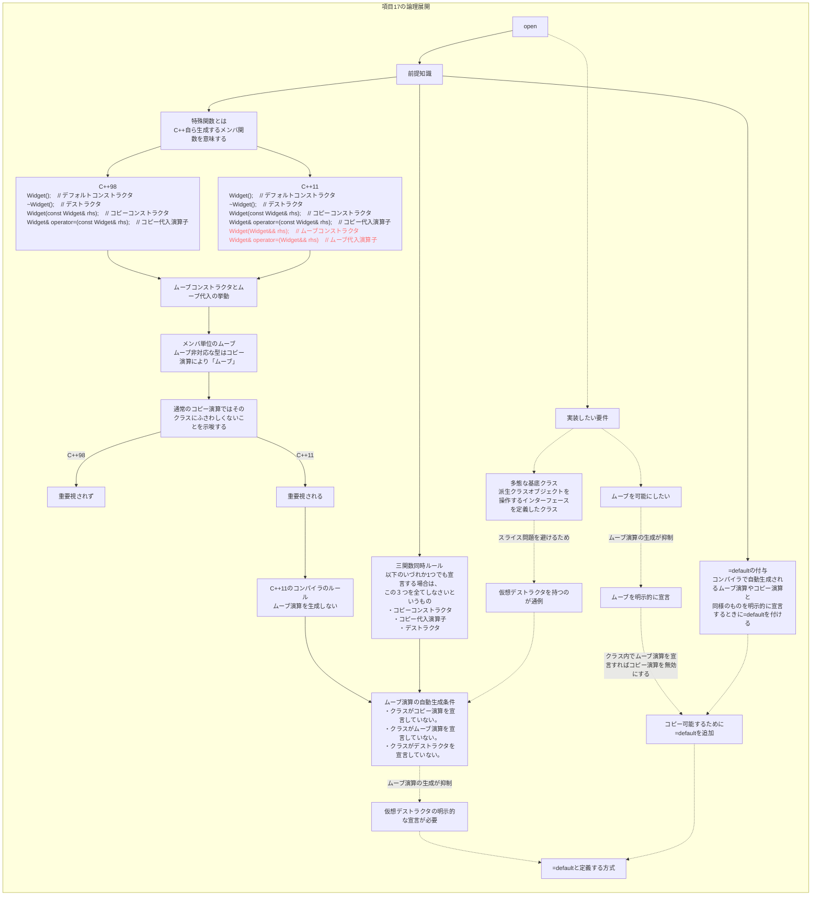
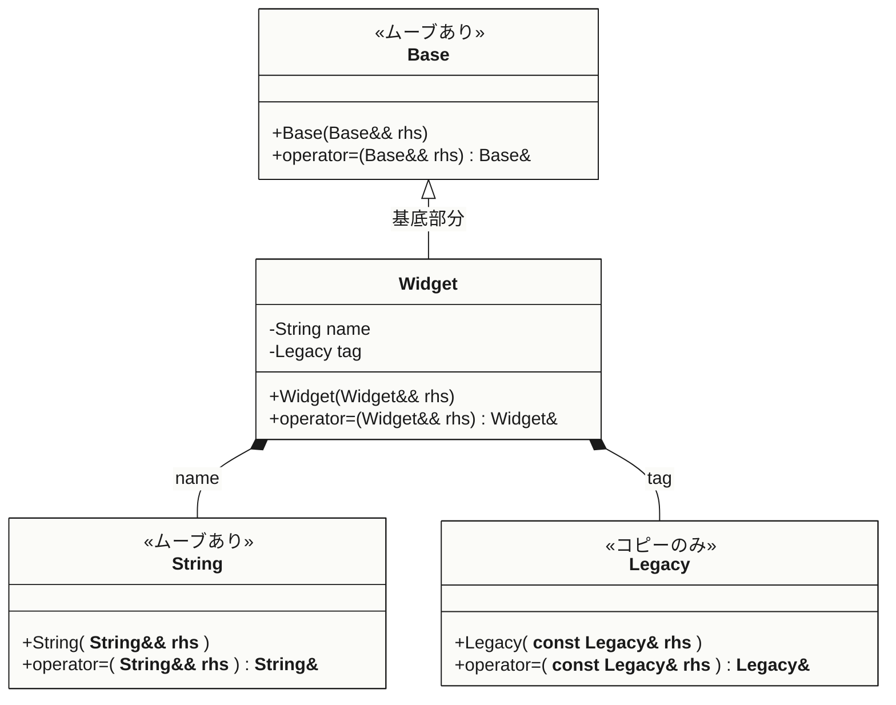
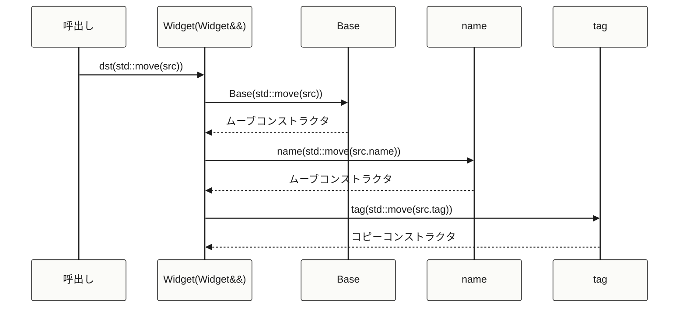
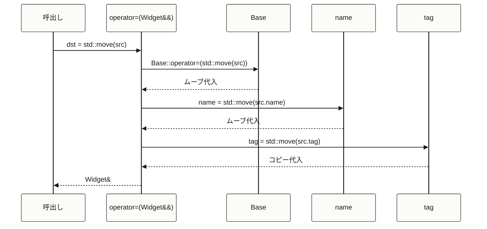

# 自動的に生成される特殊メンバ関数を理解する

<!-- %%{init: {'theme':'base','securityLevel':'loose','htmlLabels':true,'themeCSS':'strong, b, tspan[font-weight=bold] { color: #ff7070 !important; fill: #ff7070 !important; } svg, foreignObject, foreignObject div, .nodeLabel { color-scheme: light dark; } svg { background-color: transparent; } .nodeLabel { display: block !important; } .node rect, .node polygon, .node circle, .classGroup rect, rect.actor { fill: var(--vscode-editorWidget-background, light-dark(#fbfbf8, #2a2a27)) !important; stroke: var(--vscode-editor-foreground, light-dark(#1a1a1a, #e4e0d6)) !important; stroke-width: 1.5px !important; } .nodeLabel, .nodeLabel p, .nodeLabel span, .nodeLabel div, .label, .edgeLabel, .edgeLabel span, .edgeLabel p, .edgeLabel tspan, .edgeLabel text, .cluster-label, .cluster-label span, .cluster-label div, foreignObject, foreignObject div, foreignObject p, foreignObject span, .classGroup text, .classTitleText, .classText, .stereotypeText, text.actor, .messageText, .labelText, .loopText, .noteText, tspan { color: var(--vscode-editor-foreground, light-dark(#1a1a1a, #f3f1ea)) !important; fill: var(--vscode-editor-foreground, light-dark(#1a1a1a, #f3f1ea)) !important; } .edgeLabel { background-color: var(--vscode-editor-background, light-dark(#f4f4f1, #1c1c1a)) !important; } .edgeLabel rect, .labelBkg { fill: var(--vscode-editor-background, light-dark(#f4f4f1, #1c1c1a)) !important; } .cluster rect { fill: transparent !important; stroke: var(--vscode-editor-foreground, light-dark(#1a1a1a, #e4e0d6)) !important; stroke-width: 1.5px !important; } .edgePath .path, .flowchart-link, .relationshipLine, path.relation, .messageLine0, .messageLine1, .actor-line, .classGroup line { stroke: var(--vscode-editor-foreground, light-dark(#1a1a1a, #e4e0d6)) !important; fill: none !important; } .arrowheadPath, marker path, marker polygon { fill: var(--vscode-editor-foreground, light-dark(#1a1a1a, #e4e0d6)) !important; stroke: var(--vscode-editor-foreground, light-dark(#1a1a1a, #e4e0d6)) !important; } .nodeLabel pre { display: block; margin: 0; text-align: left; background: transparent; border: 0; } .nodeLabel code { color: var(--vscode-editor-foreground, light-dark(#1a1a1a, #f3f1ea)) !important; background-color: var(--vscode-textCodeBlock-background, light-dark(#e0ded8, #3d3d38)) !important; display: block; margin: 0; text-align: left; white-space: pre-wrap; font-family: Consolas, monospace; } .note { fill: var(--vscode-editorWidget-background, light-dark(#f3efe6, #34342f)) !important; stroke: var(--vscode-editor-foreground, light-dark(#1a1a1a, #e4e0d6)) !important; }','flowchart':{'htmlLabels':true,'wrappingWidth':900,'padding':12,'nodeSpacing':32,'rankSpacing':40},'themeVariables':{'background':'transparent','primaryColor':'#fbfbf8','primaryTextColor':'#1a1a1a','primaryBorderColor':'#1a1a1a','lineColor':'#1a1a1a','secondaryColor':'#f4f4f1','tertiaryColor':'#f4f4f1','textColor':'#1a1a1a','mainBkg':'#fbfbf8','nodeBorder':'#1a1a1a','edgeLabelBackground':'#f4f4f1','nodeTextColor':'#1a1a1a','clusterBkg':'transparent','clusterBorder':'#1a1a1a','titleColor':'#1a1a1a','fontSize':'16px','actorBkg':'#fbfbf8','actorBorder':'#1a1a1a','actorTextColor':'#1a1a1a','actorLineColor':'#1a1a1a','signalColor':'#1a1a1a','signalTextColor':'#1a1a1a'}}}%% -->

### クラス図は、ムーブの対象になる部分を並べたものです。

### シーケンス図は、Widget dst(std::move(src)) でその部分を宣言順に初期化する流れです。

### ムーブ代入 dst = std::move(src) も同じ順です。呼ばれるのは各部分の代入演算子です。
